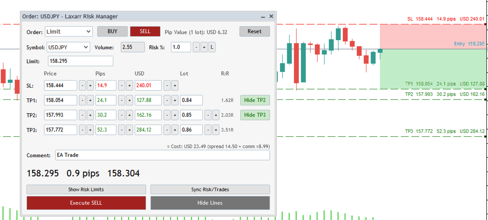
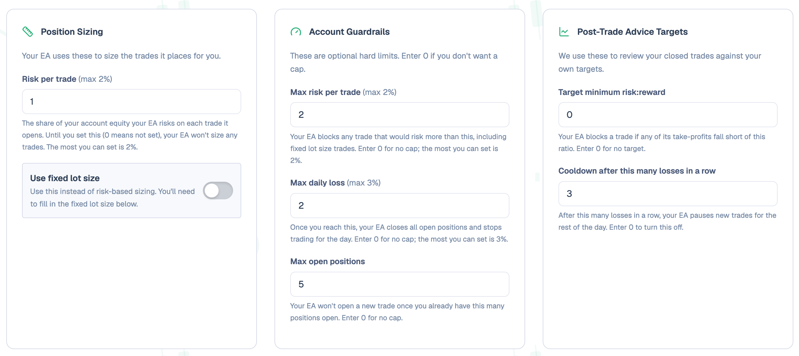

# Trading Panel (MT5 Expert Advisor)

A **risk management tool** for MetaTrader 5 — an on-chart order-entry
panel built around risk-based position sizing, account guardrails, and
live SL/TP/Entry chart visualization, rather than an autonomous trading
bot. It supports Market, Limit, Stop, and Stop Limit orders, each with up
to three take-profit levels.

**Platform:** Tested on both Windows and macOS. On macOS it runs in the
official MetaTrader 5 for Mac terminal, the same way as on Windows.

**Trade execution:** Manual only. Every order requires the trader to
click Execute and confirm a popup — nothing is submitted on the trader's
behalf without that explicit action. The exceptions are protective only:
the Max Daily Loss guardrail, if configured, automatically closes all open
positions the moment the limit is breached, and prop-challenge protection
(`ChallengeAutoClose`, on by default) closes them once
`ChallengeAutoCloseAtPercent` of a challenge loss limit is used — both
independent of any click, since protecting the account is the point.

## Configuring risk settings and guardrails

Position sizing and account guardrails are **not set inside the EA**. Each
trader configures them in their own backoffice on the trading journal web
app. The EA fetches them when it syncs, for example when you click
**Sync Risk/Trades** on the panel, and enforces them locally from then on.

The backoffice settings are grouped into three cards:

- **Position Sizing**: risk per trade (max 2%), or a fixed lot size instead
  of risk-based sizing.
- **Account Guardrails**: max risk per trade (max 2%), max daily loss
  (max 3%), and max open positions. Enter 0 for no cap.
- **Post-Trade Advice Targets**: target minimum risk:reward, and a cooldown
  after a set number of losses in a row. Enter 0 to turn either off.

To change any of these limits, update them in the backoffice and sync the
EA again.

## File overview

### `TradingPanel.mq5`
The EA's entry point. Declares the `CTradingPanelDialog` class (member
variables, control declarations, and small inline handlers), wires up
MT5's `OnInit`/`OnDeinit`/`OnTick`/`OnTimer`/`OnTradeTransaction`/
`OnChartEvent` callbacks, and includes the out-of-line method bodies below.
Also holds layout constants for the shared dialog chrome and the four
order-type panels.

### `OrderPanelBase.mqh`
The base class shared by all four order-type panels. Builds the SL/TP1/
TP2/TP3 rows (price, pips, money, risk:reward, and per-TP lot columns, all
editable and spinner-adjustable), keeps those fields in sync with each
other, and draws the corresponding chart visualization: the entry line,
profit/loss shaded zones, and price tags. TP2 and TP3 are hidden by
default — TP1 hosts a button that reveals TP2, and TP2 hosts one that
reveals TP3.

### `MarketExecutionPanel.mqh`
The Market order tab. Uses the live bid/ask as its reference price and is
the only tab currently wired to place real trades, via `CTrade`. Each
enabled take-profit level is submitted as its own independent position,
sharing the same stop loss.

### `LimitOrderPanel.mqh`
The Limit order tab. Adds a "Limit Price" field that seeds the reference
price for SL/TP calculations and the chart visualization.

### `StopOrderPanel.mqh`
The Stop order tab. Adds a "Stop Price" field that seeds the reference
price for SL/TP calculations and the chart visualization.

### `StopLimitOrderPanel.mqh`
The Stop Limit order tab. Adds both "Stop Price" and "Limit Price"
fields; the stop price serves as the reference price.

### `TradingPanelScale.mqh`
Keeps the panel the same size on every screen (Mac Retina, Windows at
125-200% scaling). MT5 scales fonts by screen DPI but not object positions
or sizes, so all panel code works in 96-DPI "panel pixels" and this file's
wrappers convert to screen pixels where pixels meet the chart. Must be
included before any `<Controls\...>` include. `tools/PanelDiagnostics.mq5`
prints the DPI and text measurements this is based on.

### `TradingPanelUI.mqh`
Everything about building and reflowing the shared chrome: the full panel
construction (`CreatePanel`), BUY/SELL tab styling, order-type and symbol
dropdown population, the collapse/expand and reflow logic that resizes the
window to match whichever rows are currently visible, the price readout,
and periodic layout self-healing. Also the chart settings the panel needs
while attached, restored on removal: chart panning is switched off while
the mouse is over the panel (so dragging on it never drags the chart), and
the terminal's own trade-history arrows/lines, which draw over the panel,
are hidden (`HideTradeHistoryOnChart`, on by default). Deals dragged in
from the History tab are sent behind the candles for the same reason. Closing the
panel (its × button) or removing the EA leaves no trace: every line, zone
and price tag is deleted and the chart's own colours, grid, candles and
settings are put back.

### `TradingPanelVolumeRisk.mqh`
The hands-free position-sizing engine. Volume is always computed to match
exactly what the trader's Max Risk % implies for the active panel's
current stop-loss distance (or, in fixed-lot mode, Risk % becomes the
derived readout instead). Also manages the Risk % manual-override lock,
which engages on a manual edit and releases after a trade executes or on
an explicit unlock click.

### `TradingPanelGuardrails.mqh`
Account-wide risk guardrails: a maximum daily loss check (enforced every
tick, independent of the Execute button), a consecutive-loss cooldown, a
pre-Execute blocking check that combines all configured limits, and the
Execute click flow itself — a trade confirmation dialog followed by
guardrail/lock bookkeeping.

### `TradingPanelRiskSync.mqh`
Fetches the trader's configured risk parameters (risk per trade, fixed lot
settings, daily loss limit, max open positions, minimum risk:reward, and
consecutive-loss limit) and renders them as a three-card summary on the
panel. Also cross-checks the account's currency and broker timezone, and
emits a periodic "still alive" heartbeat log line.

### `TradingPanelPropChallenge.mqh`
Prop-firm challenge protection. When the web app has a challenge running
on this account, its rules (account size, daily loss % and basis, the
firm's trading-day start, maximum loss and whether it trails) arrive with
the normal Sync. From then on everything is local, every tick, against
live equity — no polling: the risk cards show "Prop day left" / "Prop max
left", Execute is blocked when a trade's stop-loss risk exceeds what's
left under either limit, and positions are auto-closed near a limit if
`ChallengeAutoClose` is on. Sync and post-close trade sync also report the
account's balance/equity so the web app's challenge page can show it.

### `TradingPanelTradeSync.mqh`
Tracks and reports closed trades. Persists a watermark so only trades
closed since the last sync are sent, back-fills a bounded window of
history on first run, and estimates per-lot commission from the most
recently closed trade for the on-screen cost readout.

### `TradingPanelTradeReport.mqh`
Two related reporting features: building OHLCV candle context around each
closed trade's holding period, and capturing a closed position's full
order/deal lifecycle the moment it closes, queued and retried safely in
the background.

## Key features

- **Four order types** — Market, Limit, Stop, and Stop Limit — sharing one
  consistent SL/TP1/TP2/TP3 interface.
- **Risk-based position sizing** — Volume is derived automatically from
  Max Risk % and the current stop-loss distance, with an optional
  fixed-lot mode.
- **Account guardrails** — maximum daily loss (auto-closes all open
  positions if breached), maximum open positions, consecutive-loss
  cooldown, and minimum risk:reward enforcement, all configured in the
  journal backoffice.
- **Prop-firm challenge protection** — live daily/maximum loss headroom
  from the web app's challenge rules, trade blocking, and optional
  auto-close before a limit is hit.
- **Live chart visualization** — draggable SL/TP/Entry lines, shaded
  profit/loss zones, and price tags that track the viewport.
- **Per-TP lot splitting** — the total position size can be spread across
  up to three take-profit levels, with the split adjustable per level.
